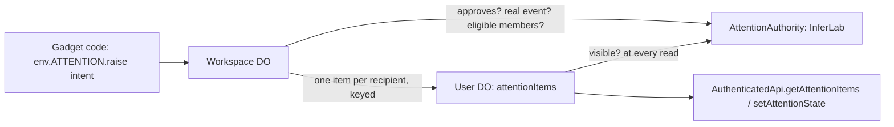

# Host attention

A Gadget can ask for people's attention without naming them, messaging them or seeing their
answer (FAC-237). It names a target **reference** and an audience **rule**; the host decides,
from InferLab's current view, who that is among the workspace's own members, and gives each one
item in their "Needs Attention" list. The contracts are InferLab's `inferlab.attention-intent` v1
and `inferlab.attention-item` v1 (pinned in `scripts/inferlab-contracts`).

## Raising: `env.ATTENTION`

`env.ATTENTION` (`packages/workshop-backend/src/attention-binding.d.ts`) is in every gadget's env
and its hooks' env, injected before the gadget's named bindings like `env.GIT`, so an existing
binding named `ATTENTION` still shadows it. The agent's executeCode env has none.

`raise(intent)` is refused unless all of these hold, in this order:

1. **The caller is an accepted gadget's own code**: a gadget or hook caller with a gadget id, for a
   gadget that exists and isn't pending, not running a chat's proposed code
   (`startGatekeeperSession`, target `"attention"`).
2. **The intent is exactly the contract.** The RPC type check (`capnweb-validate`) refuses wrong
   types; `parseAttentionIntent` refuses any key the contract doesn't name. So `recipients`, `url`,
   `preview`, a URL on the target or a list of people in the audience are refused, not dropped.
   Refusals name fields, never values.
3. **An authority is configured** (`env.ATTENTION_AUTHORITY`). Without one, attention is
   unavailable: nothing is ever delivered on the host's say-so alone.
4. **The owner has an InferLab identity**: the workspace owner's account is keyed on a stable
   subject (`account-subject.ts`), which `accountSubject` maps back.
5. **The authority approves** this workspace raising this intent: `approves({workspaceId, owner},
   intent)`. It checks the target's company and that the audience's InferLab workspace is one this
   workspace is bound to.
6. **The source event is real**: `verifyEvent({workspaceId, owner}, intent)`. It checks that a
   committed InferLab event with that id exists, read with the owner's own rights. Its resource must
   be the intent's target (tenant, kind and id), its type the reason's event
   (`review_requested`: `project.location.review_requested`), and its workspace the audience's.
   False or a throw refuses the raise.

The host then offers the authority the workspace's **owner and build collaborators** (by stable
subject; use-only collaborators and password accounts are not offered), and the authority returns
those **in the audience who can see the target now** (`eligible`). Anyone it returns who isn't one
of those members is dropped: the authority filters, it never adds. Each recipient's User DO gets
one `AttentionItem` (`attentionRaised`), with a 2-second handoff limit, like unread fanout.

A raise is idempotent, so a failure, or a recipient that didn't take the item, rejects the raise,
and the caller raises it again.

## One item per recipient

The item key is the contract's `attentionItemKey`: the recipient's subject key, the source event and
the reason. It ignores which gadget asked, so every gadget observing the same event, and every
repeat, yields the same key. The User DO keeps the first item for a key and its read state; a
repeat only records the raising workspace too.

## Why there is no rate limit

The host applies no per-gadget cap or rate limit. Event verification bounds attention instead.
An item is keyed by its source event, and `verifyEvent` admits only a real committed InferLab event
for that very target, type and workspace. So a gadget can't make a new item by inventing an event
id, and replaying a real one changes nothing. The most a gadget can cause is one item per recipient
per committed change. A committed change is an InferLab write that InferLab itself guards: the
writer's permission, an expected revision and an idempotency key (FAC-221). So the rate of
attention is the rate of real, authorized changes.

## The projection

Items live in the User DO's `attentionItems` collection (`AttentionItemRecord`: the contract item
plus the InferOS workspaces that raised it). It is a new typed-storage collection, so no migration:
existing users have none. Items survive eviction and restart like the rest of the User DO.

- **No preview to leak.** An item holds a reference and a reason, never a title or excerpt; the
  label is read at render time with the viewer's own rights (FAC-238).
- **Current visibility, at every read.** `getAttentionItems()` asks the authority `visible(subject,
  targets)` and returns only items whose target the person can still see, newest first. A revoked
  person sees nothing for it; restored access shows the stored item again with its state. Without an
  authority it returns nothing; when the authority can't tell (it throws), the read rejects rather
  than showing an empty list.
- **Personal state is separate.** `setAttentionState(itemKey, "unread" | "read" | "dismissed")` is
  the person's own and changes nothing in InferLab. An unknown key is ignored.
- **Workspace removal** removes what that workspace alone raised; an item another workspace also
  raised stays.

## Labels, opening and the Home list (FAC-238)

Home's "Needs attention" section (`packages/workshop-frontend/src/features/attention/`) shows the
person's own items, and the sidebar shows how many are unread and not dismissed.

- **Labels are read at render time, with the viewer's own rights.**
  - `describeAttentionItems(itemKeys)` looks each key up in the caller's own User DO, so a caller
    can't name someone else's target. It asks the authority's `describe(subject, targets)` and
    cleans each label: one line, no control characters, capped at 200 characters.
  - Null means the record is unknown, no longer visible or gone, and the row reads "No longer
    available", with no Open.
  - When the authority can't tell, the call rejects and Home shows an error, never "no longer
    available" and never an empty list.
- **Open never comes from a URL the item holds; it holds none.**
  - `openAttentionItem(itemKey)` looks the item up the same way and asks the authority's
    `open(subject, target)`. InferLab resolves the reference with its own resolver
    (`resource.resolve`, FAC-229), from its trusted origins.
  - The host accepts the link only if it is an absolute http(s) URL with no user info, on one of
    `INFERWORK_ORIGINS` exactly (comma-separated bare origins).
  - The page navigates to the accepted link, and only after the person clicks Open. The link grants
    nothing, and InferWork checks access again.
- **Acknowledging is personal.** Mark read, Mark unread and Dismiss call `setAttentionState` and
  change nothing in InferLab. A review stays requested until InferLab resolves it. Open also marks
  the item read.
- **States are drawn deliberately:** loading (skeleton), empty ("Nothing needs your attention."),
  error ("Couldn't check what needs your attention", with Retry), and per row "No longer
  available". Dismissed items sit behind "Show dismissed".
- **Kept current:** one store per signed-in API serves both the list and the badge, and reads again
  on focus, on becoming visible, every minute, and after each change. So another tab's change, a
  status change or a revoked target settles to what the server says.

## The authority

`AttentionAuthority` (`attention.ts`) is the one seam to InferLab, provided as the
`ATTENTION_AUTHORITY` service binding (FAC-235: `gatekeeper-inferlabops`, each person's own
InferOps connection, live). Its methods are `approves`, `verifyEvent`, `eligible`, `visible`,
and, for Home (FAC-238), `describe` and `open`. Every answer is about a stable subject; the host never decides who
holds what in InferLab, or who can see a record. Until that binding exists, attention is refused.

## Tests

`packages/workshop-backend/__tests__/attention.test.ts`, with a fake authority, covers:

- the binding's presence in a gadget's env and its absence from the agent's;
- caller refusals (agent, user, proposed code, pending and unknown gadgets);
- intent refusals (extra keys, the contract's invalid fixtures, no value echoed);
- the authority's approval;
- event verification: invented ids; a real id for another tenant, kind, record, type or
  workspace; replays; a throwing authority; reading as the owner;
- candidate selection and the dropping of non-members;
- one item per recipient across gadgets and hooks, with read state kept;
- contract-only fields;
- a revoke between raise and read, and an indeterminate authority;
- durability and read state across eviction;
- misaddressed items, and workspace removal;
- labels with the viewer's own rights: cleaning, the cap, unknown and hidden items, another
  person's key, no authority, an indeterminate answer and the batch limit;
- opening: only an http(s) link with no user info on a configured InferWork origin, only for the
  person's own item, with refusals for hidden, unavailable and indeterminate.

The Home list's component and browser tests sit beside it in
`packages/workshop-frontend/src/features/attention/`.
